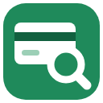
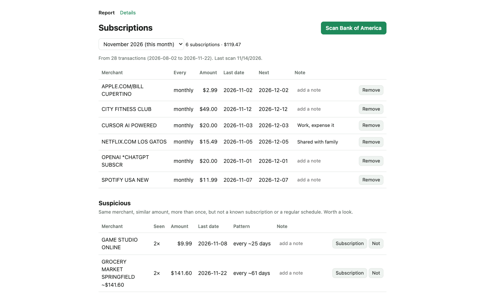

<p align="center"></p>

# Bank Charge Subscription Finder

A Chrome extension that finds the subscriptions in your Bank of America transactions and reminds you before
they renew, so a forgotten trial or an unused plan doesn't keep charging you for months.

Most subscription trackers guess from your browsing history or ask you to link an account on their website. This
one reads the charges your bank actually made, so it also finds the subscriptions you forgot about.

**Privacy promise:** the extension has no server. Your transactions, notes and settings are stored only in your browser and are never sent anywhere: not to us, not to Google, not to anyone. The only website it talks to is Bank of America itself, while you scan. The code is open source, and [an automated test](test/privacy.test.js) fails if any change would send data out. See [PRIVACY.md](PRIVACY.md).



## What it does

- **One-click scan.** Opens Bank of America and you log in yourself. It then reads up to about a year of activity on
  the accounts you pick. It never reads or fills the login form.
- **Report** of this month's subscriptions (or any month), with a **Suspicious** list: the same merchant charging a
  similar amount more than once.
- **Your call on each one.** Mark a suspicious charge as a subscription, remove things that aren't, and add notes.
- **Reminders:** a notification 3 days before each renewal, and a monthly nudge if you haven't scanned.
- **Details:** every transaction it read, with filters, CSV import and export.
- **Rebuild without logging in.** Pages read during a scan are saved locally, so improved reading code can re-read them.

## Install

From source, until it's on the Chrome Web Store:

1. Download or clone this repo.
2. Open `chrome://extensions`, turn on **Developer mode**, click **Load unpacked**, pick the folder.
3. Pin the extension icon and click **Analyze Bank of America**.

If a scan gets stuck, use **Scan this page** in its banner. You can also download a CSV from Bank of America
(Account activity → Download) and use **Import CSV** on the Details page.

## How detection works

Code in [analyze.js](analyze.js), runs entirely in the browser:

- **Subscription:** a charge that repeats on a regular schedule (weekly, monthly, quarterly, yearly) with a steady
  amount. A charge from a well-known subscription service (streaming, software, phone, internet) counts even if seen
  only once.
- One biller carrying several plans (for example `APPLE.COM/BILL` at $2.99 and $5.00) is split by amount.
- **Suspicious:** the same merchant, a similar amount (within $1 or 5%), on two or more days, but no clear schedule.
- Payments, transfers, deposits and refunds are never counted.

## Permissions

| Permission | Why |
| --- | --- |
| `bankofamerica.com` | Read your activity pages during a scan you start, only in the tab it opened |
| `storage`, `unlimitedStorage` | Keep your transactions and saved pages on your computer |
| `alarms`, `notifications` | Check for upcoming renewals and remind you |

Extension pages run with `connect-src 'none'`, so they cannot send data anywhere.

## Develop

```sh
npm test            # unit tests, including the privacy guard (Node 20+)
npm run test:e2e    # loads the extension in Playwright against a local mock page; bankofamerica.com is
                    # mapped to localhost so the real site is never contacted. Needs PLAYWRIGHT=<path to playwright>
npm run package     # dist/bank-charge-subscription-finder-<version>.zip for the Chrome Web Store
```

- [extract.js](extract.js) reads transactions from a page. It's shared by the live scan ([content.js](content.js)) and
  **Rebuild** on the Details page.
- Bank of America changes its pages from time to time. If a scan reads 0 transactions, use **Export debug info** on the
  Details page. It exports the page layout with every letter and digit masked, which is enough to fix the reading code.
- [store/LISTING.md](store/LISTING.md) has everything for a Chrome Web Store submission.

## Disclaimer

Not affiliated with, endorsed by, or supported by Bank of America. Use it with your own accounts only.
